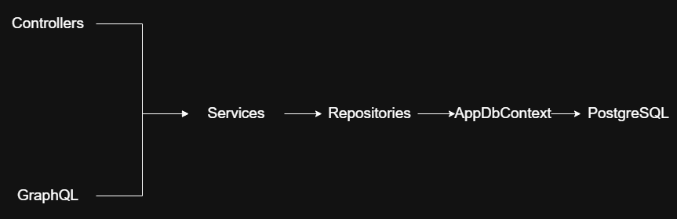

# Plataforma 24 API

API REST y GraphQL para la gestión académica de una escuela secundaria: usuarios y roles, cursos, materias, materiales de estudio, tareas y entregas, archivos, boletines bimestrales, asistencia diaria y un miniforo con moderación.

## Contenido

- [Tecnologías](#tecnologías)
- [Requisitos](#requisitos)
- [Puesta en marcha](#puesta-en-marcha)
- [Configuración](#configuración)
- [Usuarios de prueba](#usuarios-de-prueba)
- [Autenticación y permisos](#autenticación-y-permisos)
- [Arquitectura](#arquitectura)
- [Base de datos](#base-de-datos)
- [API REST](#api-rest)
- [GraphQL](#graphql)
- [Manejo de errores](#manejo-de-errores)
- [Notas para producción](#notas-para-producción)

## Tecnologías

* *Plataforma*: .NET 10 / ASP.NET Core 
* *Base de datos*: PostgreSQL 16 
* *Acceso a datos*: Entity Framework Core 10 + Npgsql 
* *Autenticación*:  JWT (Bearer) 
* *Contraseñas*: BCrypt (`BCrypt.Net-Next`) 
* *GraphQL*: HotChocolate 16 
* *Documentación*: Swagger (Swashbuckle)
* *Configuración local*: DotNetEnv (archivo `.env`) 

## Requisitos

- [.NET 10 SDK](https://dotnet.microsoft.com/download)
- [PostgreSQL 16](https://www.postgresql.org/download/) (el script de la base fue generado para esa versión)

## Puesta en marcha

**1. Clonar el repositorio**

```bash
git clone <url-del-repositorio>
cd plataforma24
```

**2. Crear la base de datos**

El esquema completo (tablas, tipos, funciones, triggers, vistas y datos de ejemplo) está en un único script. Se ejecuta sobre una base **nueva y vacía**:

```bash
createdb plataforma24
psql -d plataforma24 -f database/plataforma24.sql
```

También se puede pegar el contenido del script en la *Query Tool* de pgAdmin.

**3. Configurar las variables de entorno**

```bash
cp .env.example .env
```

Editar `.env` con la contraseña real de PostgreSQL y una clave JWT propia (ver [Configuración](#configuración)).

**4. Ejecutar**

```bash
dotnet run --launch-profile https
```
* *API (HTTPS)*: https://localhost:7070
* *API (HTTP)*: http://localhost:5136 
* *Swagger*: https://localhost:7070/swagger (solo en `desarrollo`)
* *GraphQL*: https://localhost:7070/graphql 

**5. Probar**

Iniciar sesión en Swagger (`POST /auth/login`) con alguno de los [usuarios de prueba](#usuarios-de-prueba), copiar el token, presionar **Authorize** y pegarlo **sin** la palabra `Bearer`.

El archivo `Plataforma24API.http` trae ejemplos listos para ejecutar desde Visual Studio, VS Code (extensión REST Client) o Rider.

## Configuración

La configuración sensible vive en variables de entorno, nunca en `appsettings.json`. En desarrollo se cargan desde el archivo `.env` (ignorado por Git). En otros entornos se definen como variables de entorno del sistema.

Las variables usan `__` (doble guion bajo) como separador de las secciones de `appsettings.json`.

| Variable | Obligatoria | Descripción |
|---|---|---|
| `ConnectionStrings__DefaultConnection` | Sí | Cadena de conexión a PostgreSQL. |
| `Jwt__Key` | Sí | Clave de firma de los tokens. **Mínimo 32 caracteres**, aleatoria y distinta en cada entorno. |
| `Jwt__Issuer` | No | Emisor del token. Por defecto `plataforma24` (definido en `appsettings.json`). |
| `Jwt__Audience` | No | Audiencia del token. Por defecto `plataforma24`. |
| `Jwt__ExpiracionDias` | No | Días de vigencia del token. Por defecto `7`. |

Ejemplo de .env:

```env
ConnectionStrings__DefaultConnection=Host=localhost;Port=5432;Database=plataforma24;Username=postgres;Password=mi-clave
Jwt__Key=una-clave-larga-y-aleatoria-de-al-menos-32-caracteres
```

Generar una clave aleatoria:

```
openssl rand -base64 48
```

```
# powershell
$b = New-Object byte[] 48; [Security.Cryptography.RandomNumberGenerator]::Create().GetBytes($b); [Convert]::ToBase64String($b)
```

> La aplicación **valida la configuración al arrancar**: si falta la cadena de conexión o la clave JWT es demasiado corta, no inicia y muestra un mensaje indicando qué corregir.

## Usuarios de prueba

El script de la base carga usuarios de ejemplo. La contraseña de todos es `Test1234!`.

| Rol | Email | Curso |
|---|---|---|
| Administrador | `admin@plataforma24.edu.ar` | — |
| Preceptor | `ana.torres@mail.com` | — |
| Profesor | `marcelo.diaz@mail.com` | — |
| Profesor | `laura.sanchez@mail.com` | — |
| Admin-profesor | `gustavo.romero@mail.com` | — |
| Alumno | `valentina.gomez@mail.com` | 5° 6° |
| Alumno | `lucia.martinez@mail.com` | 5° 7° |

> Son solo para desarrollo. Eliminarlos o cambiar sus contraseñas antes de publicar la aplicación.

## Autenticación y permisos

### Iniciar sesión

`POST /auth/login` devuelve un token JWT. Se envía en cada pedido:

```
Authorization: Bearer <token>
```

El token incluye el id del usuario (`idUsuario`) y su rol (`idRol`). `POST /auth/registro` crea una cuenta nueva con rol **alumno**.

### Roles

| Id | Rol | Prefijo de legajo |
|---|---|---|
| 1 | alumno | `ALU` |
| 2 | profesor | `PRO` |
| 3 | autoridad | `AUT` |
| 4 | adminAlumno | `ALU` |
| 5 | adminProfesor | `PRO` |
| 6 | admin | `ADM` |
| 7 | preceptor | `PRE` |

El legajo (por ejemplo `ALU-0001`) lo genera la base de datos automáticamente al crear el usuario.

### Políticas de autorización

Los permisos **por rol** se declaran en los controladores con `[Authorize(Policy = ...)]`:

| Política | Roles que la cumplen |
|---|---|
| `Admin` | autoridad, adminAlumno, adminProfesor, admin (ids 3 a 6) |
| `AdminOPreceptor` | `Admin` + preceptor |
| `AdminOProfesor` | `Admin` + profesor |
| `Personal` | `Admin` + profesor + preceptor |

Los permisos **por dato** (por ejemplo "solo el dueño ve su entrega" o "un alumno solo ve sus boletines publicados") se resuelven en los servicios, usando `ICurrentUser`.

## Arquitectura

El proyecto sigue una arquitectura en capas aplicando los principios SOLID. Cada capa depende de **interfaces**, no de implementaciones concretas.



| Capa | Responsabilidad |
|---|---|
| **Controllers / GraphQL** | Recibir el pedido HTTP, llamar al servicio y devolver el resultado. No contienen reglas de negocio ni acceso a datos. |
| **Services** | Reglas de negocio y permisos por dato. Lanzan excepciones de negocio (`NotFoundException`, `ForbiddenException`...). No conocen HTTP ni Entity Framework. |
| **Repositories** | Consultas a la base de datos. Encapsulan EF Core y las llamadas a funciones de PostgreSQL. |
| **Mappers** | Conversión entidad ⇄ DTO. |
| **Infrastructure** | Implementaciones técnicas: JWT, hash de contraseñas, usuario actual, almacenamiento de archivos y manejo global de errores. |

GraphQL es otra capa de presentación igual que los controladores: delega en los mismos servicios, por lo que reutiliza sus reglas de negocio y de autorización.

### Estructura de carpetas

```
plataforma24/
├── Common/
│   ├── Constants/            RolIds, AppClaims
│   ├── Exceptions/           Excepciones de negocio
│   └── Interfaces/           ICurrentUser, IJwtService, IPasswordHasher, IFileStorage
├── Controllers/              Endpoints REST
├── Data/                     AppDbContext, UnitOfWork
├── DTOs/                     Objetos de entrada y salida, por módulo
├── Extensions/               Registro de servicios (DI, base de datos, JWT, Swagger, GraphQL)
├── GraphQL/                  Consultas, mutaciones y tipos
├── Infrastructure/
│   ├── Middleware/           GlobalExceptionHandler
│   ├── Security/             JwtService, CurrentUser, BCryptPasswordHasher, Policies
│   ├── Serialization/        UtcDateTimeConverter
│   └── Storage/              LocalFileStorage
├── Mappers/
├── Models/                   Entidades, enums y vistas (solo lectura)
├── Repositories/             Implementaciones
│   └── Interfaces/
├── Services/                 Implementaciones
│   └── Interfaces/
├── database/                 Script SQL del esquema
└── Program.cs
```

### Para agregar un módulo nuevo

1. Entidad en `Models/` y `DbSet` en `AppDbContext`.
2. DTOs en `DTOs/<Modulo>/` y un mapper en `Mappers/`.
3. Interfaz e implementación del repositorio.
4. Interfaz e implementación del servicio.
5. Controlador.
6. Dos líneas en `Extensions/ServiceCollectionExtensions.cs` (repositorio y servicio).

`Program.cs` no se modifica.

## Base de datos

El esquema se gestiona con el script SQL: **el proyecto no usa migraciones de EF Core**. El script crea:

- 22 tablas, 7 vistas, 17 funciones, 9 triggers y 7 tipos enumerados.

Convenciones:

- Todas las tablas usan `id` (identity) como clave primaria; las claves foráneas se llaman `id_<tabla>`.
- Los enumerados de PostgreSQL se asocian con enums de C# en `DatabaseExtensions` (`turno`, `years`, `divisions`, `sexo`, `estado_boletin`, `estado_asistencia`, `modo_coincidencia`).
- Las vistas (`v_*`) se mapean como entidades de solo lectura en `Models/Vistas.cs`.
- Las fechas se manejan en UTC: se reciben interpretadas como UTC y se devuelven con sufijo `Z`.

### Reglas que valida la base de datos

Parte de la lógica de negocio vive en triggers y restricciones, por lo que se cumple sin importar desde dónde se acceda a los datos. El backend **no las repite**: deja que la base las haga cumplir y traduce el error a una respuesta HTTP.

- Un boletín solo se publica si todas las materias tienen nota; un boletín publicado no se modifica.
- Un profesor solo califica las materias que dicta; un alumno no puede cargar notas.
- La planilla de asistencia solo se abre en días hábiles, no en fechas futuras y dentro del ciclo lectivo; una planilla cerrada solo admite justificar inasistencias.
- El foro rechaza mensajes con palabras prohibidas y mensajes en temas cerrados; un alumno solo escribe en el foro de su curso y en el general.
- No se repiten: curso (año, división, turno y ciclo), materia dentro de un curso, entrega por alumno y tarea, DNI, email y nombre de usuario.

## API REST

La referencia completa, con modelos y ejemplos, está en **Swagger** (`/swagger`). Resumen por módulo:

| Módulo | Ruta base | Quién puede |
|---|---|---|
| Autenticación | `/auth` | `login` y `registro`: público. `profile`: usuario autenticado. |
| Usuarios | `/usuarios` | Leer: autenticado. Modificar: el propio usuario o administración. Eliminar: administración. |
| Datos personales | `/datos` | Ver, crear y modificar: el propio usuario o administración. Listar por curso: personal. Eliminar: administración. |
| Roles | `/roles` | Administración. |
| Cursos | `/cursos` | Leer: autenticado. Escribir: administración. |
| Materias | `/materias` | Leer: autenticado. Escribir: administración. |
| Períodos bimestrales | `/periodos` | Leer: autenticado. Escribir: administración. |
| Materiales | `/materiales` y `/materiales/archivos` | Leer: autenticado. Escribir: administración o profesor. |
| Tareas | `/tareas` y `/tareas/archivos` | Leer: autenticado. Escribir: administración o profesor. |
| Entregas | `/entregas` y `/entregas/archivos` | El alumno entrega y gestiona las suyas. Listar por tarea: personal. |
| Archivos | `/archivos` | Subir: autenticado (`multipart/form-data`). Descargar y ver: según permisos. Modificar y eliminar: administración. |
| Boletines | `/boletines` | El alumno ve los suyos publicados. Generar y publicar: administración o preceptor. Cargar notas: personal. |
| Asistencias | `/asistencias` | Abrir planilla y marcar asistencia: administración o preceptor. Consultar: personal. El alumno ve su resumen. |
| Foro | `/foro` | Participar: autenticado. Moderar y ver reportes: personal. |
| Palabras prohibidas | `/foro/palabras` | Administrar: administración o preceptor. `verificar`: autenticado. |

**Archivos:** se guardan en `wwwroot/uploads` (carpeta ignorada por Git). Toda ruta se valida contra esa carpeta para impedir escrituras fuera de ella.

## GraphQL

Endpoint: `POST /graphql`. Usa el mismo JWT que la API REST (`Authorization: Bearer <token>`).

| Operación | Descripción | Permiso |
|---|---|---|
| `cursos(ano, turno)` | Lista los cursos. | Autenticado |
| `materias(idProfesor, idCurso)` | Lista las materias. | Autenticado |
| `tareas(idMateria)` | Lista las tareas. | Autenticado |
| `tarea(id)` | Devuelve una tarea. | Autenticado |
| `crearTarea(entrada)` | Publica una tarea. | Administración o profesor |
| `eliminarTarea(id)` | Elimina una tarea. | Administración o profesor |

GraphQL no admite la letra `ñ` en los nombres de campo, por eso `año` se publica como **`anio`**.

Ejemplo:

```graphql
{
  cursos { id anio division turno }
  tareas(idMateria: 1) { id titulo fechaEntrega }
}
```

Más ejemplos, incluida una mutación, en `Plataforma24API.http`.

Los errores de negocio llegan con un código: `NOT_FOUND`, `FORBIDDEN`, `UNAUTHENTICATED`, `CONFLICT` o `BAD_REQUEST`.

## Manejo de errores

Todos los errores de la API REST devuelven el formato estándar `ProblemDetails`:

```json
{
  "status": 404,
  "title": "No encontrado",
  "detail": "No se encontró el curso 99."
}
```

Un único componente (`GlobalExceptionHandler`) traduce las excepciones a respuestas HTTP:

| Origen del error | Código HTTP |
|---|---|
| `NotFoundException` | 404 |
| `BadRequestException` | 400 |
| `UnauthorizedException` | 401 |
| `ForbiddenException` | 403 |
| `ConflictException` | 409 |
| Base de datos: regla de negocio no cumplida (`23514`) | 400 |
| Base de datos: acción no permitida por un trigger (`42501`) | 403 |
| Base de datos: texto no permitido en el foro (`FORO1`) | 422 |
| Base de datos: registro duplicado (`23505`) | 409 |
| Base de datos: referencia inexistente o con datos asociados (`23503`) | 400 |
| Cualquier otro error | 500 (mensaje genérico; el detalle queda en el log) |